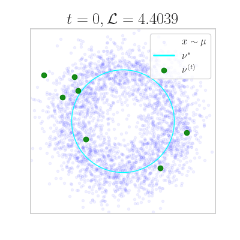
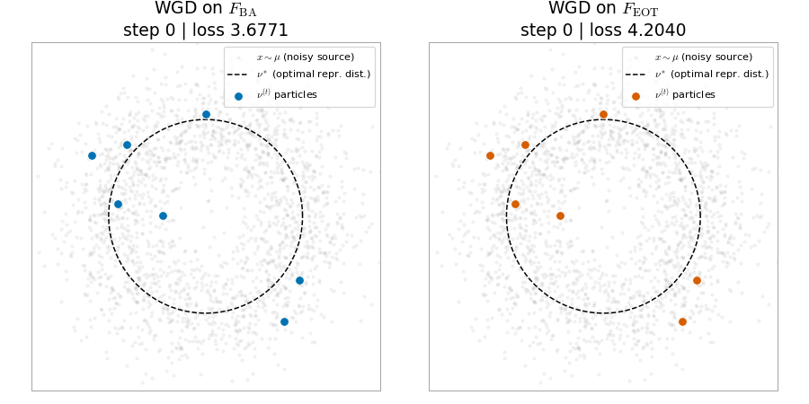

# About

This repo contains the data and code in the paper
[Estimating the Rate-Distortion Function by Wasserstein Gradient Descent](https://arxiv.org/abs/2310.18908), NeurIPS 2023.



In this work, we apply ideas and techniques from optimal transport to better solve the problem of estimating
the rate-distortion function, a fundamental quantity in information theory that
characterizes the fundamental compressibility of a given data distribution.

For an introduction to this topic, see this blog post: [part 1](https://yiboyang.com/posts/estimating-the-rate-distortion-function-of-real-world-data-part-1/), [part 2](https://yiboyang.com/posts/estimating-the-rate-distortion-function-of-real-world-data-part-2/).

**UPDATE [Nov 1, 2023]** Added WGD (demo [here](notebooks/wgd_demo.ipynb)), its hybrid variant (demo [here](notebooks/hybrid_demo.ipynb)) and Blahut--Arimoto.

**UPDATE [Jan 2024]** Added WGD on the EOT functional ([demo](notebooks/eot_wgd_demo.ipynb), [minimal example](eotgd/example.py)).



# Software
Use Python 3.12 or 3.13. Install the CPU dependencies in a fresh environment:

```sh
python -m venv .venv
source .venv/bin/activate
python -m pip install --upgrade pip
python -m pip install -r requirements.txt
python -m pip check
```

For an NVIDIA GPU on Linux, additionally install JAX's CUDA 12 runtime packages:

```sh
python -m pip install "jax[cuda12]==0.12.0.1"
JAX_PLATFORMS=cuda python -c "import jax; print(jax.devices())"
```

This requires an NVIDIA driver version of at least 525; see the
[JAX installation guide](https://docs.jax.dev/en/latest/installation.html).
JAX runs the numerical algorithms; TensorFlow handles data loading, logging, and
checkpoints on CPU. Set `JAX_PLATFORMS=cpu` to explicitly select CPU execution.
`proj_configs.py` resolves the project root from its own location.

Run the tests with `python -m pytest -q`, and run toy WGD examples with
`python -m bagd.wgd_example` (on the BA functional) or `python -m eotgd.example --steps 100` (on the EOT functional).

The code is structured as follows:

 - `common` contains common utility/boilerplate code for train/eval;
 - `ba` implements Blahut--Arimoto (with random discretization);
 - `bagd` implements WGD on the rate (BA) functional;
 - `bahybrid` implements the proposed hybrid algorithm on the rate (BA) functional;
 - `eotgd` implements WGD on the entropic optimal transport (EOT) functional, which runs Sinkhorn iterations in the inner loop and is therefore much slower than `bagd` (we recommend the latter in practice).

# Experiments
We keep all the hyperparameter settings in python scripts in the `configs/` sub-directory of each method.
We give experiment commands below running with the default hyperparameter setting. To perform hyperparameter sweeps,
loop through `hid` as follows:

    for i in {0..15}
    do
        python  -m bagd.train  --config bagd/configs/deconv_higherdims.py --hid $i --experiments_dir './results' --alsologtostderr
    done

All commands should be run from the project root directory.

# Citation
If you find this work helpful, please consider citing the paper

    @inproceedings{yang2023estimating,
      title={Estimating the Rate-Distortion Function by Wasserstein Gradient Descent},
      author={Yang, Yibo and Eckstein, Stephan and Nutz, Marcel and Mandt, Stephan},
      booktitle={Conference on Neural Information Processing Systems},
      year={2023}
    }

